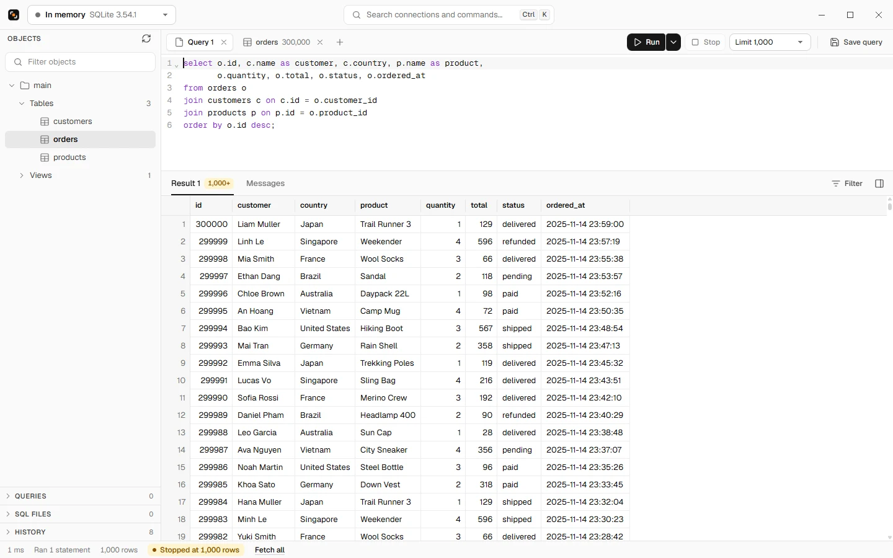

# Kemable

**A fast, light database client.** Kemable streams millions of rows into its grid without a stutter, shows the SQL before an edit is saved, and keeps out of the way of your data. One Rust core does the work; each operating system gets its own UI. Windows comes first.

[Tiếng Việt](README.vi.md) · [Website](https://kemable.pages.dev) · [Download](https://github.com/SoleBuilt/Kemable/releases/latest)



## Download

Kemable 0.1 is a preview for **Windows 10 and 11, x64**. Download `Kemable_<version>_x64-setup.exe` from the [latest release](https://github.com/SoleBuilt/Kemable/releases/latest) and run it. The installer asks whether to install for you alone or for everyone, and where. It needs WebView2, which Windows 11 has; on Windows 10 the installer fetches it.

The installer is not code-signed yet, so Windows SmartScreen may say "Windows protected your PC". Choose **More info**, then **Run anyway**. Once installed, Kemable updates itself: at launch it asks GitHub once whether a newer version exists, and installs only an installer signed by this project's release workflow.

macOS and Linux come later.

## Engines

| Engine | |
|---|---|
| SQLite | a file (Open file, Ctrl+O), or a database in memory |
| PostgreSQL | also Neon and Supabase |
| SQL Server | |
| Redis | a console of commands, keys by `SCAN` |
| Cloudflare D1 | through Cloudflare's API |
| RabbitMQ | preview |
| Firebase | Firestore and the Realtime Database, preview |

## What it does

- Results stream into a grid that scrolls millions of rows; sort and filter them in the app.
- Browse and edit tables, with the statements shown before they run, saved all or nothing.
- Live tabs that listen to PostgreSQL `NOTIFY`, Redis pub/sub, Supabase Realtime, RabbitMQ queues and Firebase, as rows.
- SSH tunnels, saved connections, `.sql` files and folders, a command palette (Ctrl+K), light and dark themes.
- Passwords stay in Windows Credential Manager. No telemetry: the only request Kemable makes on its own is the update check ([Privacy Policy](https://kemable.pages.dev/privacy)).

## Building from source

You need Rust 1.99 (`rust-toolchain.toml` installs it through rustup), Node 22 or later, pnpm, and WebView2.

```bash
cd ui/windows
pnpm install
pnpm tauri dev        # the app with hot reload; the first build takes a few minutes
pnpm tauri build      # the release app and its installer
```

Try it on two million rows: open an in-memory database from the Welcome screen, then run

```sql
with recursive c(x) as (select 1 union all select x + 1 from c limit 2000000)
select x, x * 2 as doubled, 'row ' || x as label from c
```

Before a change is done, `node scripts/verify.mjs` from the repository's root must print `PASS`. Its license checks need `cargo install --locked cargo-deny` and `cargo install --locked --features cli cargo-about` once.

## Documentation

- `AGENTS.md`: the rules every change follows, and the map of the repository.
- `core/ARCHITECTURE.md`: the core's crates and the driver contract.
- `docs/decisions/`: the decisions, one file each.
- `docs/roadmap.md`: the phases and the engines.
- `CONTRIBUTING.md`: how to contribute; a first pull request signs the [CLA](CLA.md).
- `SECURITY.md`: how to report a vulnerability.

## License

Kemable is free software under the [GNU Affero General Public License, version 3 only](LICENSE) (AGPL-3.0-only), and is also offered under a commercial license. [LICENSING.md](LICENSING.md) says which license covers what and how to ask about the commercial one; [TRADEMARKS.md](TRADEMARKS.md) covers the name and the logo; the libraries inside the app are listed in `ui/windows/THIRD-PARTY-NOTICES.md`.

```
Kemable, a fast, light database client.
Copyright (C) 2026 Huỳnh Trung Đức

This program is free software: you can redistribute it and/or modify
it under the terms of the GNU Affero General Public License as published
by the Free Software Foundation, version 3 of the License only.

This program is distributed in the hope that it will be useful,
but WITHOUT ANY WARRANTY; without even the implied warranty of
MERCHANTABILITY or FITNESS FOR A PARTICULAR PURPOSE.  See the
GNU Affero General Public License for more details.

You should have received a copy of the GNU Affero General Public License
along with this program.  If not, see <https://www.gnu.org/licenses/>.
```

Kemable is a [SoleBuilt](https://solebuilt.ducht.info.vn/) project.
